**[Portfolio](https://nolven.co.in)** · [Résumé](https://nolven.co.in/resume) · [Financial Analyst](https://nolven.co.in/financial-analyst) · [Project Manager](https://nolven.co.in/project-manager) · [Full-Stack](https://nolven.co.in/full-stack) · [Nolven tools](https://nolven.gumroad.com)

